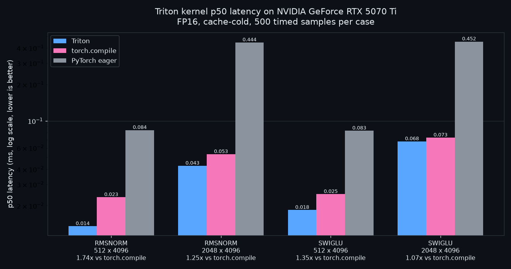

# Triton Kernel Lab

[](https://github.com/WaffleBits/triton-kernel-lab/actions/workflows/ci.yml)

GPU kernels written in OpenAI Triton for the operations LLM inference spends its time
on, each checked against a high-precision PyTorch reference and timed against compiled
PyTorch.

## Result

**Up to 2.21× faster than `torch.compile`, falling to 1.25× at the largest shape.** The
gap narrows as the work per call grows, which is why both ends are shown.

| Kernel | Shape | Triton p50 | `torch.compile` p50 | Speedup |
|---|---:|---:|---:|---:|
| RMSNorm | 128 x 1024 | 0.0058 ms | 0.0127 ms | 2.21x |
| RMSNorm | 512 x 4096 | 0.0135 ms | 0.0235 ms | 1.74x |
| RMSNorm | 2048 x 4096 | 0.0427 ms | 0.0532 ms | 1.25x |
| SwiGLU | 128 x 1024 | 0.0061 ms | 0.0126 ms | 2.07x |
| SwiGLU | 512 x 4096 | 0.0184 ms | 0.0249 ms | 1.35x |
| SwiGLU | 2048 x 4096 | 0.0678 ms | 0.0728 ms | 1.07x |



FP16 on an RTX 5070 Ti, cache-cold, 100 warmups and 500 timed samples per case. The full
record is [artifacts/rtx-5070-ti-rmsnorm-swiglu.json](artifacts/rtx-5070-ti-rmsnorm-swiglu.json).
These results are specific to this hardware and software stack.

## Run it

GPU runs need Linux or WSL with an NVIDIA GPU. CPU-side checks need neither.

```bash
python -m pip install -e ".[gpu,dev]"
triton-kernel-lab --kernel rmsnorm --kernel swiglu --shape 128x1024 --dtype float16 --output artifacts/latest.json
triton-kernel-artifacts
```

The last command recomputes every committed timing summary from its raw samples.

## Design decisions

1. **Correctness before timing.** Every kernel is compared with an FP32 reference across
   shapes and low-precision types, including the `torch.compile` baseline itself. The
   benchmark refuses to publish timings when a correctness case fails.
2. **Cache-cold by default.** A 256 MiB eviction buffer runs outside the timed region
   between samples, because a hot cache flatters a small kernel. A hot run has to be
   requested explicitly.
3. **Label what was not measured.** The bandwidth figures come from a logical model of
   the kernel and the published GPU spec. They are projections, and the report never
   presents them as hardware counters.

## Limitations

- One GPU, one driver stack, one host.
- No hardware counters. Windows has NVIDIA performance-counter access disabled on this
  host, so cache hit rates and DRAM traffic are not claimed.
- These are kernels and a measurement harness, not a serving system.

## More

- [Decode kernels, regression gate and report format](docs/RESULTS.md)
- [Methodology](docs/METHODOLOGY.md)
- [Artifact validation](docs/ARTIFACT_VALIDATION.md)
